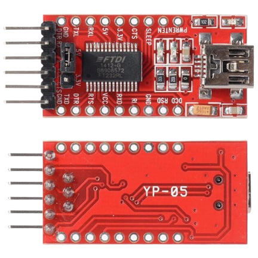
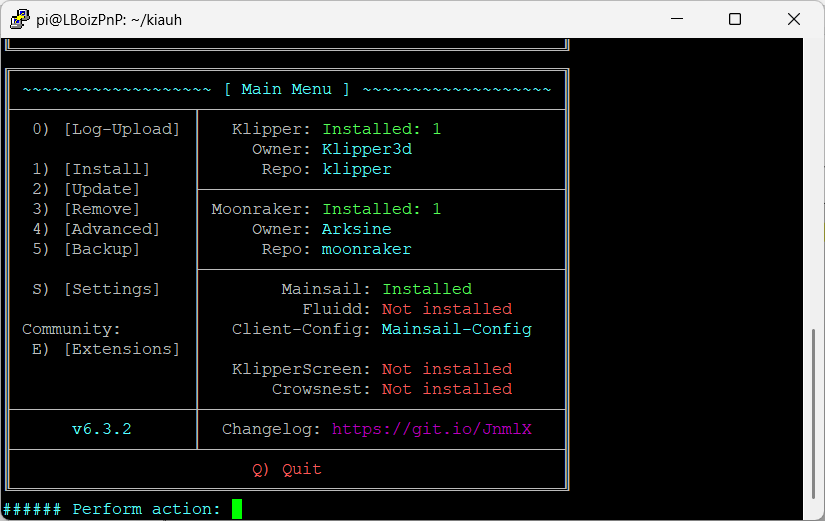
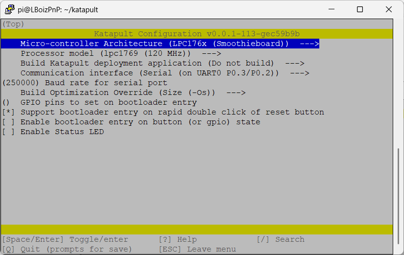
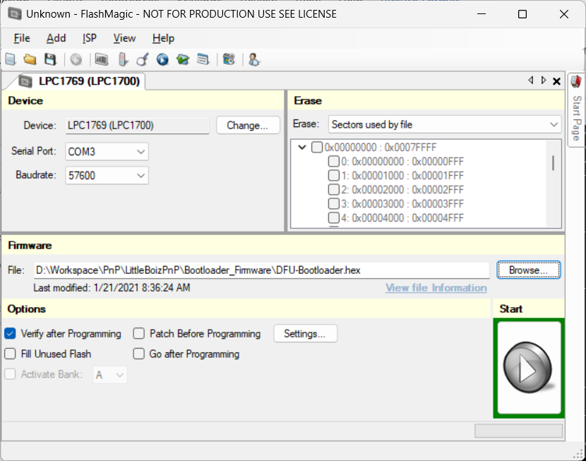
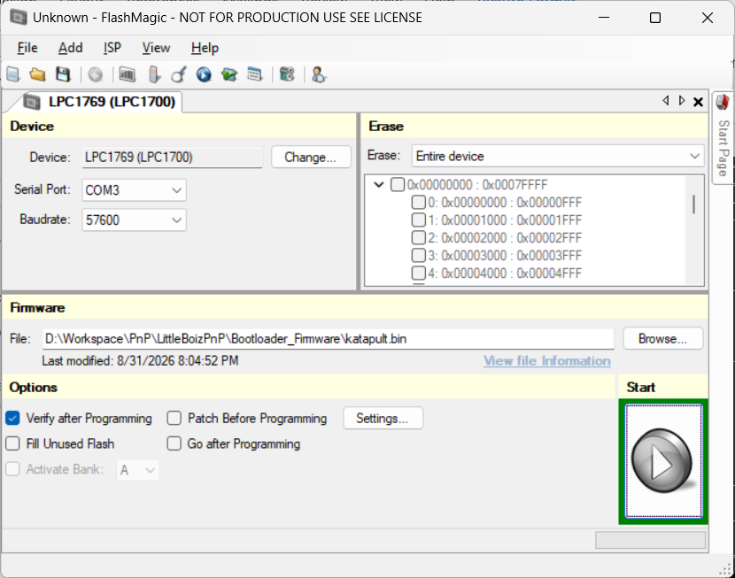
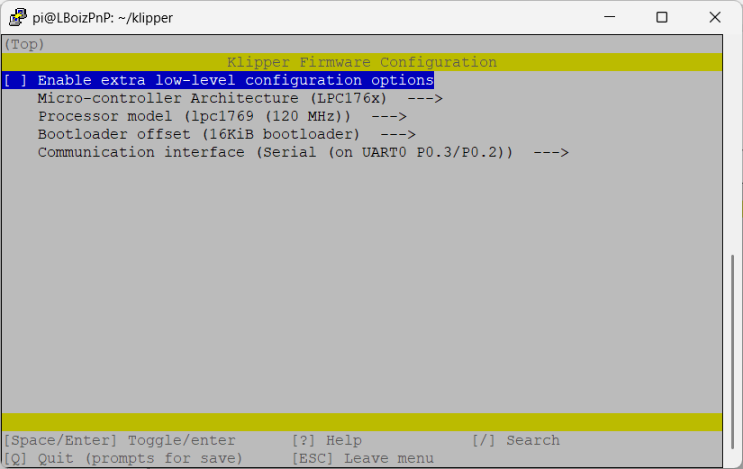
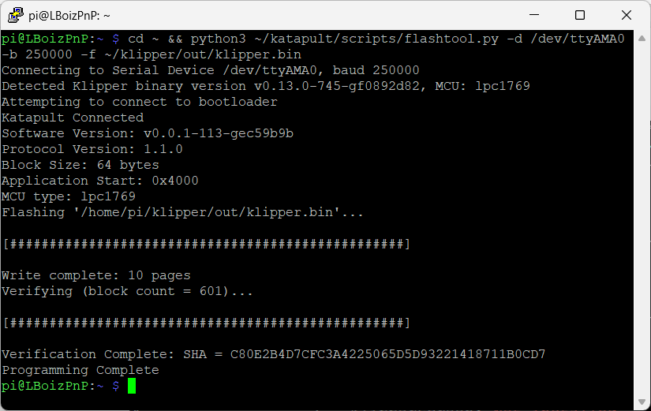

# Hướng dẫn nạp Firmware Klipper cho mạch LPC1769 (LBoiz)

Hướng dẫn này mô tả quy trình cài đặt và nạp firmware Klipper thông qua Katapult (bootloader) cho board điều khiển sử dụng vi điều khiển **LPC1769**, dùng mạch nạp **FT232RL**.

## Chọn cách nạp

| | Cách 1 | Cách 2 |
| --- | --- | --- |
| **Môi trường** | Windows + Raspberry Pi | Chỉ cần Linux |
| **Công cụ nạp** | Flash Magic (Windows) + `flashtool.py` (Raspberry Pi) | `lpc21isp` + `flashtool.py` (Linux) |
| **Cổng serial** | `/dev/ttyAMA0` (UART của Raspberry Pi) | `/dev/ttyUSB0` (FT232RL) |
| **Phù hợp khi** | Đã có Raspberry Pi chạy Klipper, dùng Windows để nạp bootloader | Chỉ có máy Linux, muốn nạp nhanh bằng dòng lệnh |

---

<details>
<summary><h2>🅰️ Cách 1: Windows + Raspberry Pi (Flash Magic)</h2></summary>

### Mục lục

- [1. Chuẩn bị và cập nhật thư viện cần thiết](#1-chuẩn-bị-và-cập-nhật-thư-viện-cần-thiết)
- [2. Cài đặt KIAUH](#2-cài-đặt-kiauh)
- [3. Cài đặt firmware Katapult](#3-cài-đặt-firmware-katapult)
- [4. Flash DFU-Bootloader](#4-flash-dfu-bootloader)
- [5. Flash firmware Katapult](#5-flash-firmware-katapult)
- [6. Cài đặt firmware Klipper](#6-cài-đặt-firmware-klipper)
- [7. Flash cấu hình firmware](#7-flash-cấu-hình-firmware)
- [Lưu ý / Xử lý lỗi thường gặp](#lưu-ý--xử-lý-lỗi-thường-gặp)

### 1. Chuẩn bị và cập nhật thư viện cần thiết

**Phần cứng:**



- Mạch nạp FT232RL

**Phần mềm (Windows):**

- [Flash Magic](https://www.flashmagictool.com/)
- [WinSCP](https://winscp.net/)

**Raspberry Pi:**

Cài đặt **Raspberry Pi OS Lite 64-bit**, sau đó chạy:

```bash
sudo apt-get update && sudo apt-get install git -y
sudo raspi-config
```

Trong `raspi-config`:

1. Chọn **3: Interface Options**
2. Chọn **6: Serial Port**
3. *Would you like a login shell to be accessible over serial?* → chọn **No**
4. *Would you like the serial port hardware to be enabled?* → chọn **Yes**

Chỉnh file cấu hình boot:

```bash
sudo nano /boot/firmware/config.txt
```

Chèn 2 dòng sau vào **cuối file**:

```
enable_uart=1
dtoverlay=disable-bt
```

Tiếp theo, chỉnh file cmdline:

```bash
sudo nano /boot/firmware/cmdline.txt
```

Tìm và xoá cụm `console=serial0,115200` (nếu có).

Cuối cùng:

```bash
sudo systemctl mask serial-getty@ttyAMA0.service
sudo reboot now
```

---

### 2. Cài đặt KIAUH



Trên Raspberry Pi, chạy:

```bash
cd ~ && git clone https://github.com/dw-0/kiauh.git
./kiauh/kiauh.sh
```

Trong menu KIAUH, cài đặt lần lượt: **Klipper → Moonraker → Mainsail**.

---

### 3. Cài đặt firmware Katapult



Trên Raspberry Pi:

```bash
cd ~ && git clone https://github.com/Arksine/katapult
cd katapult
make menuconfig
```

Trong `menuconfig`, cấu hình như sau:

| Mục                                   | Giá trị            |
| ------------------------------------- | ------------------ |
| Microcontroller Architecture          | `LPC176x`          |
| Processor model                       | `LPC1769 (120MHz)` |
| Build Katapult deployment application | `Do not build`     |
| Communication interface               | `UART (P0.3/P0.2)` |

Sau đó build:

```bash
make clean
make
```

**Chuyển file bằng WinSCP:**

1. Truy cập vào Raspberry Pi qua WinSCP.
2. Trỏ đến thư mục `/home/pi/katapult/out`.
3. Copy file `katapult.bin` về máy Windows.

---

### 4. Flash DFU-Bootloader



**Kết nối phần cứng:**

Kết nối mạch FT232RL với board LBoiz:

| FT232RL | LBoiz |
| ------- | ----- |
| GND     | GND   |
| TX      | RX    |
| RX      | TX    |

Cấp nguồn **+24V** cho mạch LBoiz.

**Đưa mạch vào chế độ ISP:**

1. Nhấn giữ nút **Boot**.
2. Nhấn **Reset** (vẫn giữ nút Boot).
3. Nhả **Reset**, sau đó nhả **Boot**.

**Cấu hình Flash Magic:**

| Thông số    | Giá trị                              |
| ----------- | ------------------------------------ |
| Device      | `LPC1769`                            |
| Serial Port | Cổng COM tương ứng với FT232RL       |
| Baudrate    | `57600`                              |
| Erase       | `Sectors used by file`               |
| Firmware    | Trỏ đến file `DFU-Bootloader.hex`    |
| Options     | Tick chọn `Verify after Programming` |

Nhấn **Start** và chờ quá trình flash bootloader hoàn tất, sau đó nhấn **Reset** trên mạch LBoiz.

---

### 5. Flash firmware Katapult



Flash file Katapult bằng Flash Magic:

1. Đưa mạch vào lại chế độ ISP (thực hiện lại bước Boot/Reset ở mục 4).
2. Cấu hình:
   - **Erase:** `Entire device`
   - **Firmware:** Trỏ đến file `katapult.bin`
   - Các cấu hình khác giữ tương tự bước flash bootloader.
3. Nhấn **Start** và chờ quá trình flash firmware hoàn tất.
4. Nhấn **Reset** trên mạch LBoiz.

---

### 6. Cài đặt firmware Klipper



```bash
cd klipper
make menuconfig
```

Cấu hình như sau:

| Mục                          | Giá trị            |
| ---------------------------- | ------------------ |
| Microcontroller Architecture | `LPC176x`          |
| Processor model              | `LPC1769 (120MHz)` |
| Bootloader offset            | `16KiB`            |
| Communication interface      | `USB`              |

```bash
make clean
make
```

---

### 7. Flash cấu hình firmware



**Kết nối phần cứng:**

Kết nối Raspberry Pi với mạch LBoiz:

| Raspberry Pi | LBoiz |
| ------------ | ----- |
| GND          | GND   |
| TX           | RX    |
| RX           | TX    |

Cài thư viện Python serial:

```bash
sudo apt install python3-serial
```

Nạp firmware:

```bash
cd ~ && python3 ~/katapult/scripts/flashtool.py -d /dev/ttyAMA0 -b 250000 -f ~/klipper/out/klipper.bin
```

Sau khi nạp thành công, nhấn **Reset** trên mạch LBoiz.

---

### Lưu ý / Xử lý lỗi thường gặp

- **Treo ở dòng "Attempting to connect to bootloader"** → Nhấn nút **Reset** trên mạch LBoiz.
- **Lỗi `FlashError: Serial device /dev/ttyAMA0 in use`** → Do Klipper đang chiếm cổng serial. Khắc phục:

  ```bash
  sudo systemctl stop klipper
  ```

  Sau đó flash lại firmware, rồi khởi động lại Klipper:

  ```bash
  sudo systemctl start klipper
  ```

</details>

---

<details>
<summary><h2>🅱️ Cách 2: Chỉ dùng Linux (lpc21isp)</h2></summary>

Cách này nạp trực tiếp từ máy Linux thông qua mạch **FT232RL**, không cần Windows và Flash Magic.

### 1. Chuẩn bị

**Phần cứng:**


- Mạch nạp FT232RL

**Phần mềm:**

Cài đặt Python 3, Git và các thư viện cần thiết:

```bash
sudo apt-get update
sudo apt-get install git python3 python3-serial -y
sudo apt-get install lpc21isp -y
```

Kiểm tra máy đã nhận mạch FT232RL chưa:

```bash
ls /dev/ttyUSB*
```

Nếu hiện `/dev/ttyUSB0` là đã nhận. Có thể kiểm tra thêm bằng:

```bash
dmesg | grep -i ftdi
```

### 2. Cài đặt KIAUH


Trên máy Linux, chạy:

```bash
cd ~ && git clone https://github.com/dw-0/kiauh.git
./kiauh/kiauh.sh
```

Trong menu KIAUH, cài đặt lần lượt: **Klipper → Moonraker → Mainsail**.

### 3. Cài đặt firmware Katapult


```bash
cd ~ && git clone https://github.com/Arksine/katapult
cd katapult
make menuconfig
```

Trong `menuconfig`, cấu hình như sau:

| Mục                                   | Giá trị            |
| ------------------------------------- | ------------------ |
| Microcontroller Architecture          | `LPC176x`          |
| Processor model                       | `LPC1769 (120MHz)` |
| Build Katapult deployment application | `Do not build`     |
| Communication interface               | `UART (P0.3/P0.2)` |

Sau đó build:

```bash
make clean
make
```

File `katapult.bin` nằm trong thư mục `~/katapult/out`.

### 4. Cài đặt firmware Klipper


```bash
cd ~/klipper
make menuconfig
```

Cấu hình như sau:

| Mục                          | Giá trị            |
| ---------------------------- | ------------------ |
| Microcontroller Architecture | `LPC176x`          |
| Processor model              | `LPC1769 (120MHz)` |
| Bootloader offset            | `16KiB`            |
| Communication interface      | `USB`              |

```bash
make clean
make
```

### 5. Kết nối phần cứng

Kết nối mạch FT232RL với board LBoiz:

| FT232RL | LBoiz |
| ------- | ----- |
| GND     | GND   |
| TX      | RX    |
| RX      | TX    |

Cấp nguồn **+24V** cho mạch LBoiz.

### 6. Nạp DFU-Bootloader

**Đưa mạch vào chế độ ISP:**

1. Tháo USB FT232RL khỏi máy tính.
2. Giữ nút **ISP** + **RESET**.
3. Cắm USB FT232RL vào máy tính.
4. Nhả **ISP** + **RESET**.

**Nạp bootloader** (chạy lệnh trong thư mục chứa file `DFU-Bootloader.hex`):

```bash
lpc21isp -control -wipe DFU-Bootloader.hex /dev/ttyUSB0 115200 12000
```

### 7. Nạp Katapult

5. Đưa mạch vào lại chế độ ISP (lặp lại các bước 1–4 ở mục 6).
6. Nạp `katapult.bin`:

   ```bash
   cd ~/katapult/out
   lpc21isp -control -wipe -bin katapult.bin /dev/ttyUSB0 115200 12000
   ```

7. Khi chạy xong, **KHÔNG ĐƯỢC NHẤN RESET**.

### 8. Nạp Klipper


8. Chạy lệnh:

   ```bash
   cd ~ && python3 ~/katapult/scripts/flashtool.py -d /dev/ttyUSB0 -b 250000 -f ~/klipper/out/klipper.bin
   ```

9. Sau khi nạp thành công, nhấn **RESET** trên mạch LBoiz.

### Lưu ý / Xử lý lỗi thường gặp

- **Không thấy `/dev/ttyUSB0`** → Kiểm tra lại cáp USB, hoặc rút ra cắm lại FT232RL.
- **Lỗi `Permission denied` khi truy cập `/dev/ttyUSB0`** → Thêm user vào nhóm `dialout`, rồi đăng xuất và đăng nhập lại:

  ```bash
  sudo usermod -aG dialout $USER
  ```

- **Treo ở dòng "Attempting to connect to bootloader"** → Nhấn nút **RESET** trên mạch LBoiz.
- **Lỗi `FlashError: Serial device ... in use`** → Có chương trình khác đang chiếm cổng serial. Nếu máy Linux đang chạy Klipper, dừng lại trước khi nạp:

  ```bash
  sudo systemctl stop klipper
  ```

  Sau khi nạp xong thì khởi động lại:

  ```bash
  sudo systemctl start klipper
  ```

</details>
