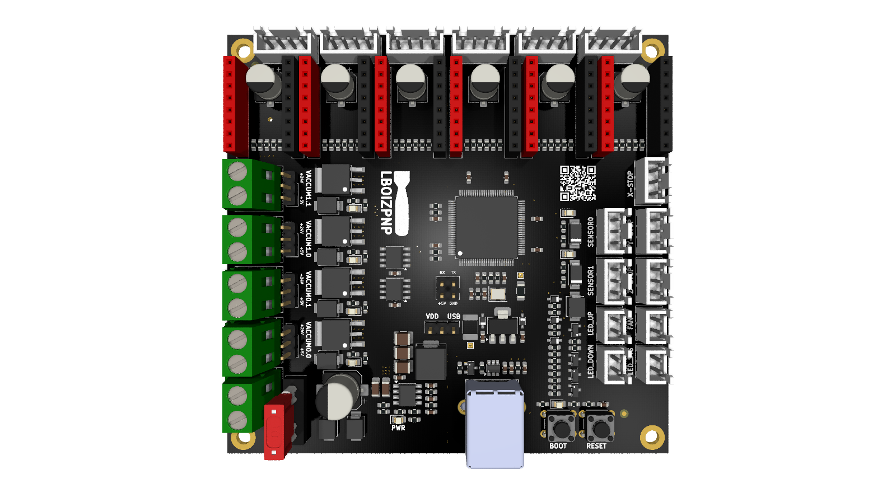

# ⚡ LBoizPnP Custom Mainboard

Đây là kho lưu trữ toàn bộ hồ sơ thiết kế phần cứng (Hardware Design Files) cho bo mạch chủ của dự án **LBoizPnP Machine**. Bo mạch được thiết kế chuyên biệt để làm cầu nối trung gian giữa vi điều khiển (chạy Klipper) và các cơ cấu chấp hành cơ điện tử của máy Pick and Place.

---

## 🌟 Tính năng phần cứng nổi bật (Hardware Features)

* **Thiết kế nguồn an toàn & cách ly:** Tích hợp cầu chì bảo vệ 10A và Diode Schottky SS56 (5A/60V) chống ngược cực dòng cao. Đường nguồn 5V logic được cách ly nhiễu hoàn toàn khỏi đường nguồn 24V động lực, sử dụng IC Buck hiệu suất cao LMR14030.
* **Điều khiển chuyển động tĩnh lặng:** Tích hợp đế cắm tiêu chuẩn cho driver **TMC2209**. Giao tiếp UART trực tiếp với MCU, hỗ trợ vi bước (Microstepping) cao và chế độ StealthChop2 giúp triệt tiêu rung động cơ khí.
* **Đóng ngắt tải cảm công suất cao:** Sử dụng MOSFET công suất kết hợp Diode dập xung ngược (Flyback Diode) để điều khiển an toàn các tải nặng như: Bơm hút chân không, Van điện từ Juki Nozzle, và hệ thống LED Vision.
* **Chuẩn hóa gia công:** Thiết kế đã được tối ưu hóa Layout, đồng bộ lưới tọa độ (Origin Point) và sẵn sàng cho việc gia công cắm dán linh kiện tự động (SMT Pick & Place).

---

## 📁 Cấu trúc thư mục & File thiết kế (Release Files)

| File             | Chức năng & Mục đích sử dụng                                                                                                                           |
|:---------------- |:------------------------------------------------------------------------------------------------------------------------------------------------------ |
| **Schematic**    | **Sơ đồ nguyên lý:** Dùng để tra cứu mạch, kiểm tra logic kết nối và debug tín hiệu điện.                                                              |
| **BlockDiagram** | **Sơ đồ khối:** Hiển thị tổng quan luồng điện áp và kiến trúc giao tiếp của các phân hệ trên bo.                                                       |
| **Gerber**       | **File sản xuất PCB:** Gói gọn toàn bộ các lớp mạch (Đồng, lụa, mặt nạ hàn). Nén sẵn để upload trực tiếp lên JLCPCB, PCBWay...                         |
| **BOM**          | **Danh sách linh kiện (Bill of Materials):** Đã được chuẩn hóa định dạng, chứa cột MPN và Số lượng, sẵn sàng nạp vào công cụ BOM Tool của LCSC/JLCPCB. |
| **AssemblyTop**  | **Bản vẽ lắp ráp (Mặt Top):** Sơ đồ linh kiện loại bỏ các thông số Value thừa, giúp định vị nhanh chân cắm và chiều linh kiện khi hàn tay.             |
| **DrillMap**     | **Bản đồ mũi khoan:** Bảng mô tả chi tiết đường kính và tọa độ các lỗ xuyên hole/via trên mạch.                                                        |
| **3DPCB**        | **Mô hình 3D (STEP):** Bo mạch hoàn chỉnh dạng 3D khối đặc, dùng để import vào SolidWorks/Fusion360 khi thiết kế vỏ hộp bảo vệ.                        |
