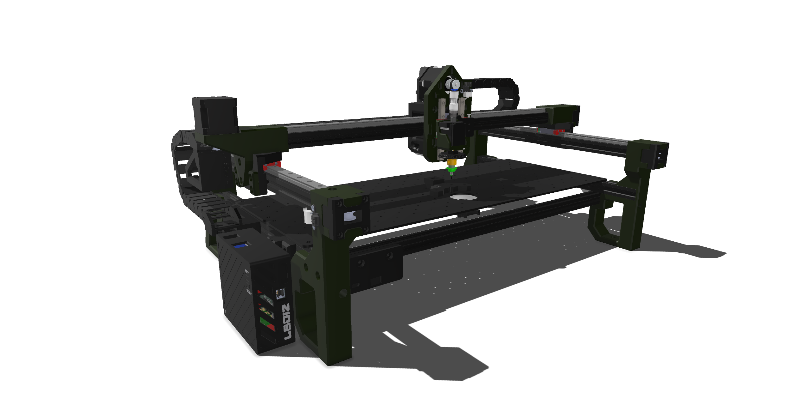

# 🏭 LBoizPnP Machine Project

## 📊 1. Tiến độ Thực tế Dự án (Project Status Tracking)

Dự án hiện đang được triển khai theo mô hình cơ điện tử song song. Dưới đây là bảng phân rã trạng thái của từng phân hệ tính đến thời điểm hiện tại:

| Phân hệ (Subsystem) | Nội dung công việc chi tiết | Trạng thái thực tế | Ghi chú kỹ thuật |
| :--- | :--- | :---: | :--- |
| **Cơ khí (Mechanical)** | Thiết kế, gia công khung vỏ và cơ cấu chuyển động dựa trên LumenPnP; tối ưu hóa kích thước nhỏ gọn hơn bản gốc. | 🟢 **Hoàn thành** | Đã lắp ráp phần cứng khung trục cố định. |
| **Phần mềm (Software Integration)** | Cài đặt Firmware Klipper, thiết lập kiến trúc Host-MCU và cấu hình giao tiếp đồng bộ với phần mềm OpenPnP. | 🟢 **Hoàn thành** | Giao tiếp API và xử lý chuỗi lệnh G-Code ổn định. |
| **Thiết kế Mainboard (Custom PCB Design)** | Thiết kế Schematic và Layout bo mạch chủ trên KiCad. Tích hợp đế cắm driver động cơ bước TMC2209, khối nguồn hạ áp (Buck 24V sang 5V), hệ thống bảo vệ ngược cực và cụm điều khiển tải cảm (bơm, van). | 🟢 **Đang triển khai** | Đang tối ưu hóa Layout, chuẩn bị xuất file BOM/CPL để gia công SMT. |
| **Vận hành Trục (Kinematics & Motion)** | Kiểm tra các trục chuyển động (X, Y, Z, C), hiệu chuẩn thông số bước (Step/mm), gia tốc (Acceleration) và công tắc hành trình (Endstops). | 🟢 **Đang thực hiện** | Đang tinh chỉnh độ rung động và độ chính xác lặp lại. |
| **Hệ thống Cấp phôi (Feeder System)** | Thiết kế cơ khí, chế tạo và lập trình các cụm Feeder tự động đẩy băng linh kiện (Tape Feeders). | 🔴 **Chưa triển khai** | Sẽ bắt đầu sau khi hoàn thiện kiểm tra bộ khung và bo mạch. |
| **Thị giác Máy (Computer Vision)** | Lắp đặt hệ thống Camera (Top & Bottom Vision), cấu hình OpenPnP nhận diện lỗ băng, viền linh kiện và căn chỉnh tọa độ. | 🟡 **Đang triển khai** | Đợi hoàn thiện hệ thống cơ khí và cụm đầu hút. |

## ⚙️ 2. Kiến trúc Hệ thống Tổng quan (System Architecture)

Hệ thống PnP được cấu thành từ sự kết hợp chặt chẽ giữa cơ khí chính xác, bo mạch điều khiển chuyên dụng và phần mềm thời gian thực:

### 2.1. Phân hệ Cơ khí & Khí nén
* **Khung máy:** Nhôm định hình chất lượng cao kết hợp với các cấu kiện gia công CNC và in 3D chịu lực cao (PETG/ABS). Thiết kế được thu gọn diện tích chiếm dụng (Footprint) tối đa nhằm tăng tính cơ động.
* **Đầu hút (Toolhead):** Hỗ trợ gắn kim hút linh kiện khí nén (Juki Nozzles). Lực gắp và nhả linh kiện được điều khiển thông qua hệ thống van điện từ và bơm chân không.

### 2.2. Phân hệ Điều khiển & Firmware
Dự án áp dụng giải pháp phân tán tác vụ xử lý để tối ưu hóa hiệu năng chuyển động:
* **OpenPnP (Host):** Đóng vai trò là "bộ não trung tâm" chạy trên máy tính. Chịu trách nhiệm xử lý các thuật toán thị giác máy tính (Computer Vision), quản lý danh sách linh kiện (BOM), tối ưu hóa đường đi gắp đặt, và gửi tập lệnh di chuyển xuống hệ thống.
* **Bo mạch chủ (Custom Mainboard):** Phần cứng trung gian giao tiếp giữa vi điều khiển và các cơ cấu chấp hành. Được thiết kế chuyên biệt để phân bổ nguồn điện an toàn (cách ly nhiễu, bảo vệ quá dòng), điều khiển motor tĩnh lặng qua UART và đóng ngắt các tải công suất (bơm, van, LED).
* **Klipper (Firmware):** Chạy trực tiếp trên vi điều khiển phối hợp cùng máy tính nhúng. Klipper chịu trách nhiệm tính toán quỹ đạo chuyển động bước nâng cao, bù trừ sai số cơ khí và thực thi các lệnh chuyển động với độ chính xác thời gian thực cực cao.

## 🚀 3. Hướng dẫn Vận hành Cơ bản (Getting Started)

1. Kiểm tra toàn bộ kết nối cơ khí và độ căng của dây đai trục X/Y.
2. Cấp nguồn tổng cho hệ thống.
3. Khởi động máy chủ chạy phần mềm Klipper và kết nối giao tiếp.
4. Khởi chạy phần mềm OpenPnP trên máy tính điều khiển, thực hiện lệnh `Home All` để thiết lập điểm gốc tọa độ máy trước khi tiến hành hiệu chuẩn động học chuyên sâu.
